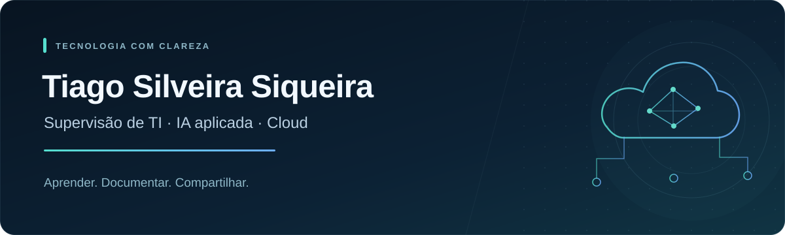

# Olá, sou o Tiago.

Atuo na **supervisão de TI** e compartilho projetos que aproximam infraestrutura, Microsoft Azure e IA aplicada à rotina técnica.

Meu interesse é transformar conhecimento em algo que outra pessoa consiga usar: um laboratório executável, um procedimento claro ou um exemplo que ajude a fazer perguntas melhores. Aqui, documentação, aprendizagem e revisão fazem parte do projeto.

## Comece por aqui

| Se você quer… | Explore | O que você encontra |
| --- | --- | --- |
| Executar um exemplo | [Azure + IA: laboratório de operações](https://github.com/TiagoSilveiraSiqueira/azure-ai-operations-lab) | Triagem com dados fictícios: demonstração em Python e opção com modelo local |
| Reutilizar instruções | [Skills para times de TI](https://github.com/TiagoSilveiraSiqueira/skills-para-times-de-ti) | Runbooks, triagem de incidentes e onboarding técnico |
| Avaliar respostas | [Engenharia de prompts na prática](https://github.com/TiagoSilveiraSiqueira/engenharia-de-prompts-na-pratica) | Estudos com prompts, saídas ilustrativas e critérios de avaliação |

**Uma rota para quem está começando:**

1. Rode o modo `demo` do laboratório de operações. Ele funciona com dados sintéticos e regras, sem precisar de um modelo ou de uma conta cloud.
2. Escolha uma skill e experimente suas instruções com um cenário fictício.
3. Compare dois prompts usando a rubrica dos estudos. Confira os fatos e registre o que a resposta realmente mostrou.

## Infraestrutura e Azure

Esses estudos complementam o trabalho com agentes e documentação:

- [Azure VM Management Lab](https://github.com/TiagoSilveiraSiqueira/azure-vm-management-lab): estudo documentado de criação e gerenciamento de máquinas virtuais no Azure, com simulação.
- [Monitoramento no Azure com Azure Monitor](https://github.com/TiagoSilveiraSiqueira/Monitoramento-no-Azure-com-Azure-Monitor): estudos de monitoramento no Azure.

## Técnica, liderança e aprendizagem

**Decisões com contexto.** Explicar o problema, as alternativas, os limites e como conferir o resultado.

**Documentação que ajuda o time.** Transformar procedimentos em runbooks e trilhas de onboarding que outra pessoa consiga acompanhar.

**IA com revisão.** Separar evidências de hipóteses, identificar informações ausentes e avaliar a resposta antes de usá-la.

**Conhecimento compartilhado.** Usar exemplos em português para facilitar o início de quem está entrando em cloud e IA aplicada.

Os exemplos publicados nestes projetos usam dados fictícios. As demonstrações distinguem o que foi executado do que é ilustrativo e deixam explícitos seus limites.

## Áreas de interesse

Supervisão de TI · Infraestrutura e operações · Microsoft Azure · Observabilidade · Agentes de IA · Skills · Engenharia de prompts

Contribuições com correções, dúvidas e novos exemplos são bem-vindas nos repositórios. Uma boa pergunta também ajuda a melhorar a documentação.

---

**English:** IT supervisor exploring infrastructure, Azure and applied AI. I share practical labs, reusable instructions and prompt evaluation studies to help people get started.
